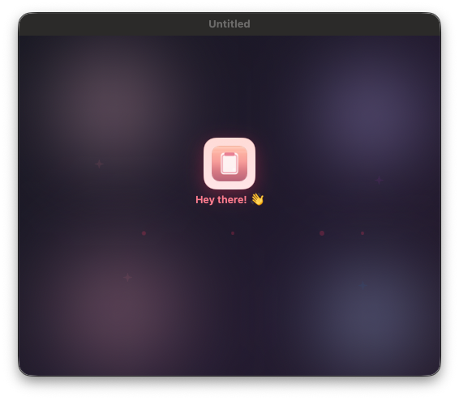
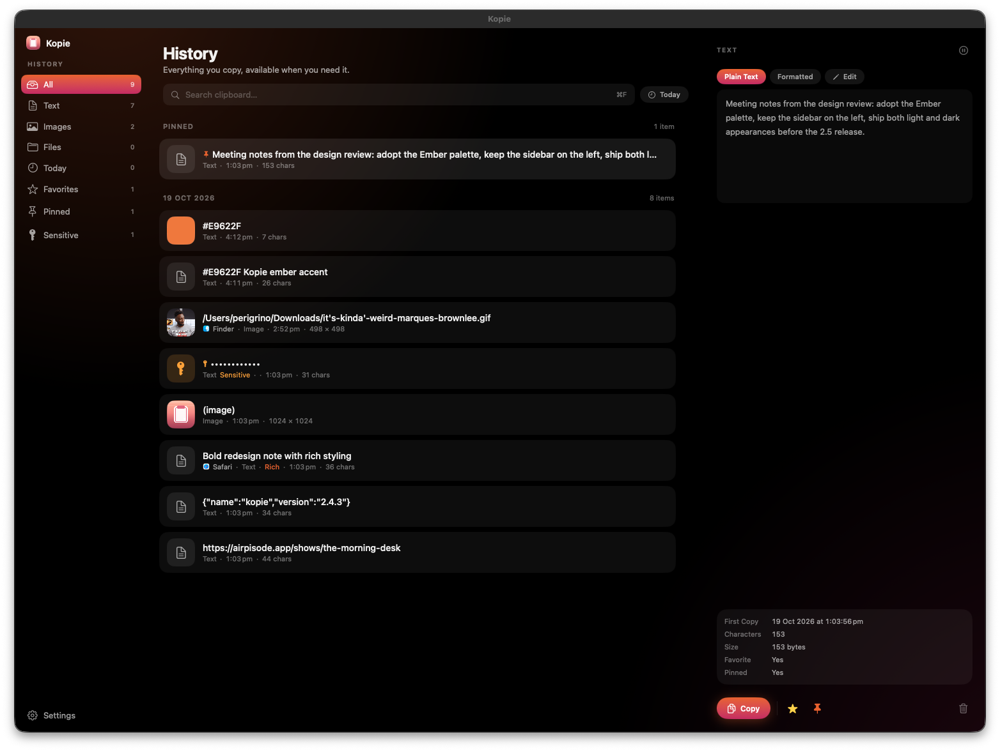
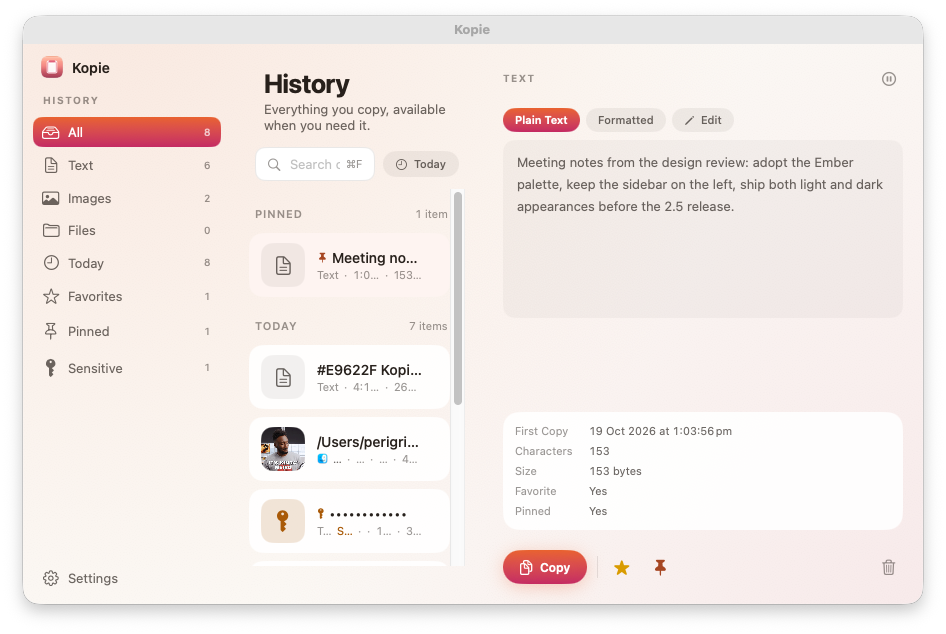
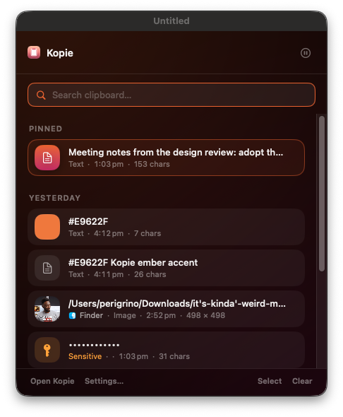
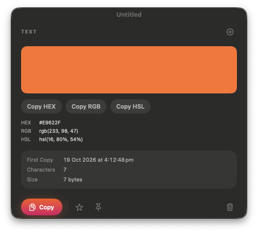
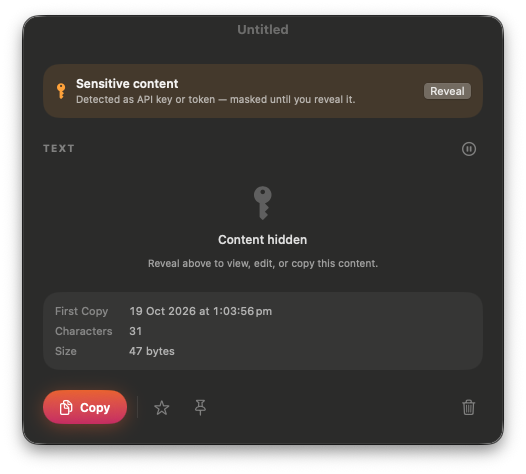
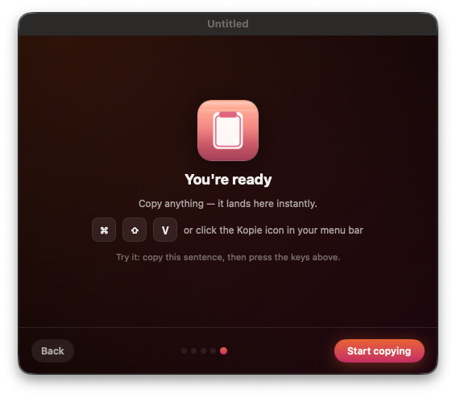

# Kopie

<p align="center">
  
</p>

Native macOS clipboard manager — menu-bar first, fast, local-only.
Copy something, find it later, paste it back.

<p align="center">
  
</p>

## Screenshots

| | |
|---|---|
|  |  |
| *Light mode — same Ember theme, warm paper* | *Menu-bar popover — search, day groups, copy-back* |
|  |  |
| *Copied colors become swatches with Copy HEX / RGB / HSL* | *Sentinel masks a detected API token until revealed* |
|  | |
| *Onboarding ends by teaching the hotkey* | |

## Why Kopie?

- **Private by design** — your clipboard never leaves your Mac. No cloud, no accounts, no telemetry.
- **Fast** — menu-bar and keyboard first, opens instantly, searches as you type.
- **Native** — Swift + SwiftUI, with one small audited dependency (Sparkle) for signed in-app updates.
- **Open source** — the whole app is public on [GitHub](https://github.com/Perigrino/Kopie). Read the code, verify exactly what it does with your clipboard, and contribute.

## Features

- Captures text and images copied anywhere on your Mac
- Full light & dark appearance with the Ember theme — every surface tokens both modes
- Live search with day-grouped history, sidebar filters, and image thumbnails
- Copy-back via global hotkey (`⌘⇧V`), direct paste (`⌥↩`), quick-select (`⌥1`–`⌥9`)
- OCR — find screenshots by the words inside them (fully on-device)
- Paste as plain text (`⌃` while copying)
- Formatted viewer with syntax highlighting (JSON, HTML, SQL, Swift, …) and rich-text rendering
- Inline editing (`⌘E`), favorites, multi-select delete, paste queue
- Shortcuts / Siri app intents; retention cleanup with favorites protected
- Ignore-list for sensitive apps; on-device notifications for pause/clear

## Requirements

macOS 13 Ventura or later.

## Updates

Kopie checks a signed [appcast](https://perigrino.github.io/Kopie/appcast.xml) at most once a day and can install new versions in place. Every update archive is verified with an Ed25519 key embedded in the app, independent of HTTPS. Downloads and release notes live on GitHub Releases; the appcast lives on GitHub Pages. You can also check manually from **Settings → General → Software Update** or the menu-bar menu.

Phase 1 releases are ad-hoc signed and not notarized. The first download may require right-click **Open** or **System Settings → Privacy & Security → Open Anyway**; updates Sparkle installs in place are signature-verified and release their quarantine flag before launch. See [docs/UPDATES.md](docs/UPDATES.md) for the release checklist, Gatekeeper details, and the key setup.

## Development

```bash
swift test        # core engine unit tests (or: npm test)
npm run dev       # debug build + assemble + open Kopie.app
npm run build     # release build (dist/Kopie.app)
npm run package   # release build + dist/Kopie.dmg
bash scripts/acceptance.sh   # headless full workflow
```

Ad-hoc signed by default so local builds keep their Accessibility grant; set `KOPIE_SIGN_IDENTITY` before `npm run package` to sign with a local identity. Phase 1 CI releases are ad-hoc only; Developer ID signing and notarization are planned for Phase 2.
